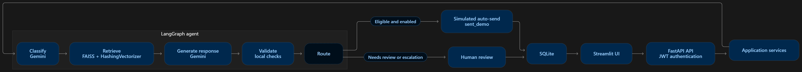

# SupportFlow AI

<p align="left">
  <a href="https://www.python.org/"></a>
  <a href="https://fastapi.tiangolo.com/"></a>
  <a href="https://streamlit.io/"></a>
  <a href="https://www.langchain.com/langgraph"></a>
  <a href="https://www.langchain.com/"></a>
  <a href="https://ai.google.dev/gemini-api"></a>
  <a href="https://github.com/facebookresearch/faiss"></a>
  <a href="https://scikit-learn.org/"></a>
  <a href="https://numpy.org/"></a>
  <a href="https://www.sqlalchemy.org/"></a>
  <a href="https://www.sqlite.org/"></a>
  <a href="https://docs.pytest.org/"></a>
  <a href="https://www.docker.com/"></a>
  <a href="https://render.com/"></a>
</p>

**AI-assisted customer support email agent for triage and response handling, with retrieval-grounded reply drafts, safety checks, human review, and simulated auto-send.**

SupportFlow AI processes customer support requests through an end-to-end workflow. It classifies intent, retrieves relevant guidance from a FAISS knowledge base, drafts and validates a reply, then routes sensitive or uncertain cases for human review. Eligible responses can be recorded as simulated sends.

> The inbox contains synthetic data. Gmail and Outlook are not connected, and no real email is sent. A `sent_demo` response is recorded in the application database.

[](https://customer-support-email-agent.streamlit.app/)

### Home Dashboard


## What it does

- Provides a shared demo workspace with JWT-based sign-in and a seeded synthetic inbox.
- Lets a reviewer create a synthetic support case and run the agent workflow.
- Classifies cases as `product_question`, `bug_report`, `billing_issue`, `feature_request`, `complex_issue`, or `other`.
- Retrieves excerpts from Markdown support documents using a local FAISS index.
- Generates a reply draft using the configured Gemini model.
- Checks for a missing draft, wording overlap with retrieved knowledge, and unsupported numbers.
- Routes cases to escalation or human review when configured checks require it.
- Can mark eligible product-question replies as `sent_demo` when simulated auto-send is enabled.
- Lets a reviewer edit, approve, and record a manual demo send.
- Persists cases, agent runs, and responses in SQLite.
- Includes a labeled evaluation script and unit/integration tests.

## Screenshots

### Create and process a synthetic case


### Eligible product question and simulated send


### Escalated billing case and draft for review


## Architecture



## Agent workflow

1. **Receive:** Save a synthetic customer email as a case.
2. **Classify:** Ask the configured LLM to assign an intent and confidence score.
3. **Retrieve:** Search the Markdown knowledge base for relevant excerpts.
4. **Draft:** Ask the LLM to prepare a response using the customer message and retrieved context.
5. **Validate:** Run local checks for draft presence, wording overlap, and unsupported numbers.
6. **Route:** Escalate when safety checks require it; otherwise require human review unless the case meets every simulated auto-send rule.
7. **Record:** Save the agent run and response status in SQLite and display them in the workspace.

### Simulated auto-send rules

Simulated auto-send is **off by default** in `.env.example`. When enabled, a reply is eligible only when all configured checks pass:

- The intent is `product_question`.
- Classification confidence meets `AUTO_SEND_CONFIDENCE_THRESHOLD`.
- Retrieval score meets `AUTO_SEND_MIN_RETRIEVAL_SCORE`.
- Relevant knowledge was retrieved.
- Draft validation passed.
- No escalation reason or workflow error was recorded.

Eligible responses are saved as `sent_demo`, and the inbox case is marked `processed`. This is a database action only; it does not send email. Billing, account-specific, and complex cases are not eligible for this auto-send path.

## Technology stack

| Area | Technology | Use in this project |
| --- | --- | --- |
| Backend API | Python, FastAPI, Pydantic | API routes, request validation, and response schemas |
| Application structure | Services, repositories, SQLAlchemy | Separates business logic, persistence, and API handling |
| Database | SQLite | Stores synthetic emails, agent runs, responses, and demo users |
| Authentication | JWT | Protects workspace API routes after demo sign-in |
| Agent orchestration | LangGraph | Connects the classification, retrieval, generation, validation, and routing nodes |
| LLM integration | LangChain OpenAI-compatible client with Gemini | Classification and response generation |
| Retrieval | FAISS CPU, scikit-learn `HashingVectorizer`, NumPy | Builds and searches a local knowledge index |
| User interface | Streamlit | Demo login, inbox, case details, agent test, and knowledge-base pages |
| Evaluation and tests | pytest, labeled JSON fixtures | Checks workflow behavior and measures results on synthetic cases |
| Containers | Docker, Docker Compose | Runs the API and Streamlit UI locally |

The retrieval vectors are generated locally with scikit-learn’s `HashingVectorizer`; the configured `EMBEDDING_MODEL` setting is not used for the current implementation. Vectors are normalized and searched with FAISS inner product. Retrieval is therefore primarily based on wording similarity.

Draft validation is a local heuristic. It can flag limited overlap or unsupported numbers, but it does not establish that an answer is factually correct.

## Repository structure

```text
supportflow-ai/
├── app/
│   ├── ai/
│   │   ├── retrieval/
│   │   │   ├── embeddings.py          # Local text vectors using HashingVectorizer
│   │   │   ├── retriever.py           # Retrieves relevant knowledge chunks
│   │   │   └── vector_store.py        # Builds and searches the FAISS index
│   │   ├── workflow/
│   │   │   ├── nodes/
│   │   │   │   ├── classify.py        # Classifies customer intent
│   │   │   │   ├── retrieve.py        # Retrieves knowledge for a case
│   │   │   │   ├── generate.py        # Generates a reply draft
│   │   │   │   ├── validate.py        # Runs local response checks
│   │   │   │   └── escalation.py      # Routes to review or simulated auto-send
│   │   │   ├── graph.py               # Connects the LangGraph workflow
│   │   │   └── state.py               # Data passed between workflow nodes
│   │   ├── llm.py                     # Gemini client setup
│   │   └── prompts.py                 # Loads prompt templates
│   ├── api/
│   │   ├── routes/
│   │   │   ├── auth.py                # Demo sign-in and current user
│   │   │   ├── emails.py              # Create and view synthetic email cases
│   │   │   ├── agent.py               # Run and retrieve agent results
│   │   │   ├── responses.py           # Edit, approve, and record demo sends
│   │   │   ├── knowledge_base.py      # View documents and rebuild the index
│   │   │   └── health.py              # Hosting health check
│   │   └── dependencies.py            # Database and JWT authentication dependencies
│   ├── core/
│   │   ├── config.py                  # Environment-based settings
│   │   ├── exceptions.py              # Application exceptions
│   │   └── logging.py                 # Logging setup
│   ├── database/
│   │   ├── connection.py              # SQLAlchemy engine and sessions
│   │   └── init_db.py                 # Database table initialization
│   ├── integrations/                  # Provider interface and placeholders
│   │   ├── base.py                    # Email provider interface
│   │   ├── mock_email.py              # Mock provider placeholder
│   │   ├── gmail.py                   # Gmail integration placeholder
│   │   └── outlook.py                 # Outlook integration placeholder
│   ├── models/                        # SQLAlchemy database models
│   │   ├── user.py
│   │   ├── email.py
│   │   ├── agent_run.py
│   │   └── response.py
│   ├── repositories/                  # Database access for application services
│   │   ├── user_repository.py
│   │   ├── email_repository.py
│   │   ├── agent_repository.py
│   │   └── response_repository.py
│   ├── schemas/                       # Pydantic API request and response schemas
│   │   ├── auth.py
│   │   ├── common.py
│   │   ├── email.py
│   │   ├── agent.py
│   │   └── response.py
│   ├── services/                      # Authentication and application logic
│   │   ├── auth_service.py
│   │   ├── demo_seed_service.py       # Seeds the synthetic demo inbox
│   │   ├── email_service.py
│   │   ├── agent_service.py
│   │   ├── response_service.py
│   │   └── knowledge_base_service.py
│   └── main.py                        # FastAPI app and startup initialization
├── data/
│   ├── knowledge_base/                # Markdown support knowledge
│   │   ├── accounts.md
│   │   ├── billing.md
│   │   ├── products.md
│   │   ├── refunds.md
│   │   └── subscriptions.md
│   ├── vector_store/
│   │   └── .gitkeep                   # Generated FAISS files are rebuilt at startup
│   └── evaluation_results.json        # Detailed results from the latest evaluation
├── docs/
│   ├── screenshots/                   # Demo login, dashboard, and workflow screenshots
│   └── workflow-diagram.png           # Agent and application architecture diagram
├── prompts/
│   ├── classification.txt             # Intent-classification prompt
│   └── response_generation.txt        # Reply-generation prompt
├── scripts/
│   ├── evaluate_agent.py              # Evaluates the agent on labeled examples
│   ├── ingest_knowledge_base.py       # Rebuilds the FAISS index
│   └── seed_mock_emails.py            # Adds synthetic email examples
├── tests/
│   ├── fixtures/
│   │   ├── evaluation_emails.json
│   │   └── mock_emails.json
│   ├── integration/
│   │   ├── test_agent_service.py
│   │   ├── test_agent_workflow.py
│   │   └── test_api.py
│   └── unit/
│       ├── test_response_service.py
│       └── test_schemas.py
├── ui/
│   ├── components/
│   │   └── status_badge.py            # Displays case and response statuses
│   ├── pages/
│   │   ├── 1_Test_Agent.py            # Create and process a synthetic case
│   │   ├── 2_Inbox.py                 # Search and filter the inbox
│   │   ├── 3_Email_Details.py         # Review and manage a suggested reply
│   │   └── 4_Knowledge_Base.py        # Browse documents and rebuild the index
│   ├── api_client.py                  # Streamlit-to-FastAPI requests and login state
│   └── Home.py                        # Login page and workspace dashboard
├── .dockerignore                      # Excludes local-only files from Docker builds
├── .env.example                       # Example configuration and public demo credentials
├── .gitignore                         # Excludes secrets, databases, and generated files
├── Dockerfile                         # Backend container definition
├── docker-compose.yml                 # Local backend and UI services
├── requirements.txt                   # Python dependencies
└── README.md
```

The local SQLite database, its backup, .env, virtual environment, and generated FAISS index files are intentionally not shown as repository files. Keep the Gmail and Outlook entries labeled as placeholders: those external mailbox integrations are not connected to the current project workflow.

## Configuration

Copy `.env.example` to `.env` for local development and set the required values. Keep `.env` private; do not commit API keys or local secrets.

| Variable | Purpose |
| --- | --- |
| `APP_NAME`, `APP_VERSION` | Application name and version |
| `ENVIRONMENT`, `DEBUG` | Runtime environment and debug mode |
| `API_HOST`, `API_PORT` | Local API settings |
| `DATABASE_URL` | SQLAlchemy database URL; defaults to local SQLite |
| `LLM_PROVIDER` | Selects the configured model provider; this code expects `gemini` |
| `LLM_MODEL` | Gemini model identifier supported by your account |
| `LLM_BASE_URL` | Gemini OpenAI-compatible API endpoint |
| `LLM_API_KEY` | Gemini API key; keep it secret |
| `VECTOR_STORE_PATH` | Path where the generated FAISS index is stored |
| `AGENT_CONFIDENCE_THRESHOLD` | Minimum classification confidence before the workflow flags uncertainty |
| `AUTO_SEND_ENABLED` | Enables or disables simulated auto-send |
| `AUTO_SEND_CONFIDENCE_THRESHOLD` | Minimum confidence for simulated auto-send eligibility |
| `AUTO_SEND_MIN_RETRIEVAL_SCORE` | Minimum retrieval score for simulated auto-send eligibility |
| `JWT_SECRET_KEY` | Secret used to sign demo access tokens; use a unique random value |
| `JWT_ALGORITHM` | JWT signing algorithm |
| `JWT_ACCESS_TOKEN_EXPIRE_MINUTES` | Demo access-token lifetime |
| `DEMO_ADMIN_EMAIL` | Shared demo account email |
| `DEMO_ADMIN_PASSWORD` | Shared demo account password |
| `DEMO_COMPANY_NAME` | Name displayed for the synthetic workspace |
| `BACKEND_URL` | API base URL used by Streamlit |

Gemini API quotas and hosting free-tier availability depend on the providers’ current terms. The application is designed for a free-tier-friendly demo, but external model calls still require a configured API key and available quota.

## Evaluation

The latest recorded evaluation used **18 synthetic, hand-labeled email examples** and rebuilt the index from **5 Markdown files (14 chunks)**. Simulated auto-send was enabled for this run.

| Metric | Result |
| --- | ---: |
| Examples evaluated | 18 |
| Classification coverage | 18/18 (100%) |
| Intent classification accuracy | 17/18 (94.44%) |
| Expected-source retrieval hit rate | 12/12 (100%) |
| Draft validation pass rate | 17/18 (94.44%) |
| Escalation rate | 4/18 (22.22%) |
| Eligible for simulated auto-send | 2/18 (11.11%) |
| Average workflow latency | 2.56 seconds |
| Classification failures | 0 |

The expected-source retrieval metric applies only to the 12 examples with an expected source label. Auto-send eligibility measures how many examples passed the configured policy; it does not measure factual correctness or email delivery. These results describe a small synthetic dataset and should not be treated as production performance.

The latest test run reported locally was **11 passed**.

Run the full evaluation from the project root in PowerShell:

```powershell
$env:AUTO_SEND_ENABLED = "true"
python -m scripts.evaluate_agent --delay 5
Remove-Item Env:AUTO_SEND_ENABLED
```

The environment setting applies to that PowerShell session. The evaluation script runs the graph against labeled examples and writes details to `data/evaluation_results.json`; it does not save responses or send email. If evaluation stops with an error, remove the temporary variable in a separate command:

```powershell
Remove-Item Env:AUTO_SEND_ENABLED
```

## Run locally

Create a virtual environment and install the requirements:

```powershell
python -m venv .venv
.\.venv\Scripts\Activate.ps1
python -m pip install -r requirements.txt
```

If `.env` does not already exist, copy the example file. Set the Gemini API key, JWT secret, and demo login values in `.env`.

```powershell
if (-not (Test-Path .env)) { Copy-Item .env.example .env }
```

Start the backend from the project root:

```powershell
python -m uvicorn app.main:app --host 127.0.0.1 --port 8000 --reload
```

In a second terminal, activate the same virtual environment and start Streamlit:

```powershell
.\.venv\Scripts\Activate.ps1
python -m streamlit run ui/Home.py
```

Open the Streamlit URL printed in the terminal. FastAPI documentation is available at `http://127.0.0.1:8000/docs`.

At startup, the backend initializes the database, creates the demo account if needed, seeds sample cases that are not already present, and rebuilds the FAISS index.

Run tests from the project root:

```powershell
python -m pytest -q
```

Some workflow integration tests call the configured LLM and require network access and available model quota.

## Docker Compose

With a configured `.env` file, run both services from the project root:

```powershell
docker compose up --build
```

- Streamlit UI: `http://localhost:8501`
- FastAPI API: `http://localhost:8000`
- FastAPI docs: `http://localhost:8000/docs`

## Git and deployment

Before pushing, verify that local secrets and generated files are not staged:

```powershell
git status --short --branch
git ls-files .env data/app.db data/evaluation_results.json data/vector_store
```

The intended free-tier deployment uses a Docker web service for FastAPI and Streamlit Community Cloud for the UI. Configure the backend environment variables in the backend host and set `BACKEND_URL` and the matching demo login values in the Streamlit app’s secrets. Do not put `LLM_API_KEY` or `JWT_SECRET_KEY` in the UI’s secrets.

Free services may sleep, and free hosting filesystems may be ephemeral. With SQLite on an ephemeral filesystem, demo records can be lost after a restart. The application rebuilds the FAISS index from the Markdown files at startup.

## Limitations and future scope

Current limitations:

- Uses synthetic emails and one shared demo workspace, not real company inboxes or multi-tenant accounts.
- Gmail and Outlook integrations are placeholders; OAuth, mailbox sync, and real delivery are not implemented.
- Simulated sending records `sent_demo`; no external email is delivered.
- Retrieval uses local lexical hashing and may miss synonyms or paraphrases.
- Validation uses simple local checks and cannot guarantee factual accuracy.
- Evaluation data is small and synthetic.
- SQLite records may not persist on hosts with ephemeral filesystems.

Possible future work:

- Add a real email provider integration with explicit OAuth consent and scoped access.
- Add tenant isolation, roles, and organization-level authentication.
- Use a managed persistent database for hosted deployments.
- Compare semantic embedding models and reranking approaches.
- Expand the evaluation set and measure answer quality, routing quality, and safety separately.
- Add audit logs, monitoring, and operational metrics.

## Project impact

SupportFlow AI demonstrates an end-to-end, safety-oriented support workflow: straightforward product questions can qualify for a simulated automated response, while uncertain or risky cases remain visible for human review. On the current 18-example evaluation set, the workflow achieved **94.44% intent accuracy** and retrieved the expected source for **12/12 labeled retrieval cases**. These are project evaluation results, not claims of measured business savings or real email automation.

## Author

**Arjun Goel**

MCA'27@VIT Vellore

- **Email:** [arjun11goel@gmail.com](mailto:arjun11goel@gmail.com)
- **LinkedIn:** [linkedin.com/in/arjun11goel](https://www.linkedin.com/in/arjun11goel/)
- **Porfolio:** [arjun11goel.vercel.app](https://arjun11goel.vercel.app)

---

*Built as a Generative AI customer support email agent project exploring LangGraph workflow orchestration, Gemini-powered intent classification and reply drafting, FAISS retrieval with scikit-learn HashingVectorizer, response validation, human review, simulated auto-send, and agent evaluation.*